# Parent's Guide

**A benefits guide for future parents.** A responsive web app for expecting parents, parents of young children, adoptive parents and foster families. It shows the sickness-insurance entitlements that match the user's situation, calculates benefits for both parents, helps plan leave and walks the user through the applications.

The interface is available in **English (default) and Polish** – switch with the **EN / PL** button next to the accessibility buttons.

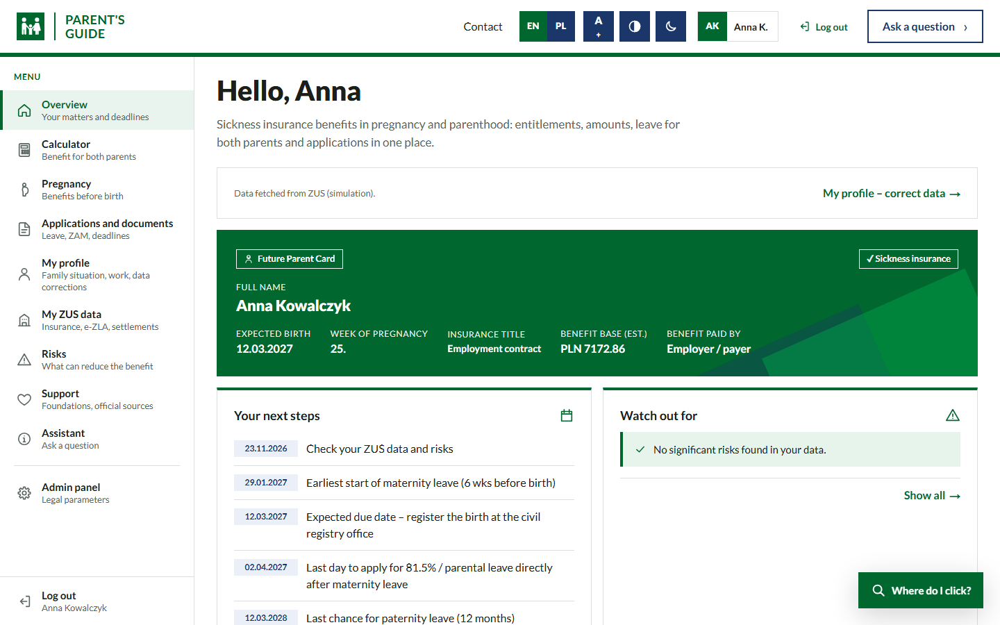

> [!IMPORTANT]
> **HackNation competition project – this is not a ZUS service.**
> Logging in to ZUS and via mObywatel, data from ZUS systems (KSI/PUE), e-ZLA, the certificate of amounts due and sending applications are **simulated** (mock-ups). All people and data are fictitious. The app does not connect to any ZUS system or to the mObywatel app – do not enter real data.


## Demo showcase

> [!TIP]
> **Watch the demo video:** click the thumbnail below to watch it on YouTube.
>
> [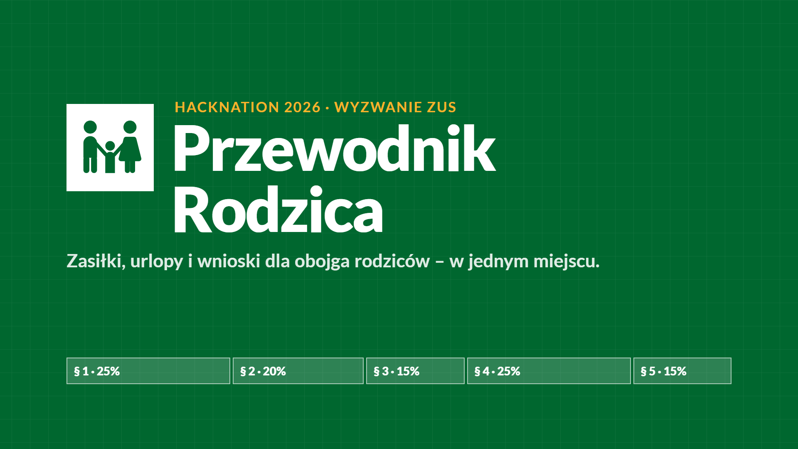](https://youtu.be/YUEiUQ1e5fU)

---

## Table of contents

1. [Problem](#problem)
2. [Solution](#solution)
3. [Features](#features)
4. [Test accounts](#test-accounts)
5. [Quick start](#quick-start)
6. [Configuration](#configuration)
7. [Architecture](#architecture)
8. [REST API](#rest-api)
9. [AI features](#ai-features)
10. [Data storage](#data-storage)
11. [Accessibility, appearance and language](#accessibility-appearance-and-language)
12. [Mapping to the challenge requirements](#mapping-to-the-challenge-requirements)
13. [Compliance of forms with ZUS templates](#compliance-of-forms-with-zus-templates)
14. [Assumptions to verify with ZUS](#assumptions-to-verify-with-zus)
15. [Path to production](#path-to-production)

---

## Problem

Future parents, including adoptive parents and foster families, have to find their own way through scattered and complicated rules on sickness-insurance benefits. They don't know which benefits they are entitled to during pregnancy and after the birth, how much the benefit will be, how to split leave between both parents, or which documents to submit and where. As a result they often lose money, miss deadlines or overlook risks – e.g. unpaid contributions when self-employed, or ZUS challenging the benefit base.

## Solution

After logging in with mObywatel (simulated), the app fetches data from ZUS or lets the user fill it in through a short survey. Based on that, it shows the benefits that match the parent's situation and calculates maternity and parental benefit for both parents. It simulates splitting leave and combining it with part-time work, tells the user which documents to submit, by when, and whether to the employer or to ZUS. It also warns about risks, while AI answers questions in plain language and reads PDF documents.

---

## Features

| Screen | Path | What it does |
|---|---|---|
| **Login** | `/` | The “Log in to ZUS” button opens a login mock-up: “Log in with mObywatel” shows a QR code with a validity countdown and a simulated scan; login and password are only a mock-up. The page also has “Create an account” (without ZUS data), quick login to test accounts and a no-login mode. |
| **Create an account** | `/nowe-konto` | A step-by-step survey (role, stage of parenthood, dates, employment). Questions can be skipped and answered later. |
| **Dashboard** | `/pulpit` | Summary of the situation, upcoming deadlines, shortcuts to services. |
| **Calculator** | `/kalkulator` | Maternity and parental benefit for both parents, including: number of children, “Za życiem” (For Life), premature baby, stillbirth / death of the child, taking over leave, the 9 non-transferable weeks, work at ¼ / ⅓ / ½ time, comparison of 81.5% with 100% / 70%, adoption and foster family. |
| **Pregnancy** | `/ciaza` | Sickness benefit during pregnancy, rehabilitation benefit, benefit equal to maternity benefit, and situations with no right to benefits. |
| **Applications and documents** | `/wnioski` | Which documents, where (payer or ZUS) and when to submit them. ZUS forms reproduced 1:1 from the templates (ZAM, ZAS-53, Z-3, Z-3a, ZAS-12 – see [Form compliance](#compliance-of-forms-with-zus-templates)), applications to the employer compliant with the regulation in Journal of Laws 2025 item 322 (§ 2–§ 20: maternity, parental, paternity, supplementary leave, leave on maternity-leave terms, special situations, work during parental leave, childcare leave) and a copy of the birth certificate – with print preview and simulated sending (UPO). |
| **My ZUS data** | `/zus` | Insurance and benefit bases, e-ZLA preview, certificate of amounts due as of a chosen day, certificates, a question to ZUS. |
| **My profile** | `/profil` | View and correct data. With ZUS data, changed fields are marked and the ZUS value can be restored. |
| **Test cases** | `/sprawy` | 12 built-in cases with the expected result, plus uploading PDF documents (Z-3, Z-3a, ZAM, ZAS-53, ZAS-12, insurance confirmations, e-ZLA). |
| **Risks** | `/ryzyka` | General risks and risks calculated from the person's data: sham employment, raising the base during pregnancy, end of insurance, amounts due, missing code B. |
| **Support** | `/wsparcie` | Help organisations filtered by situation, and official sources (ZUS, MRPiPS, PIP). |
| **Assistant** | `/asystent` | Questions and answers in plain language (AI or rule-based answers). |
| **Admin panel** | `/admin` | Editing legal parameters (rates, leave lengths, deadlines) with versioning and change history. Requires a PIN. |
| **More** | `/wiecej` | Appearance and language settings and other shortcuts, especially useful on a phone. |

### Screenshots

**Calculator** – the total benefit for both parents, the leave plan on a timeline and the period details, next to the inputs (situation, benefit base, leave split).

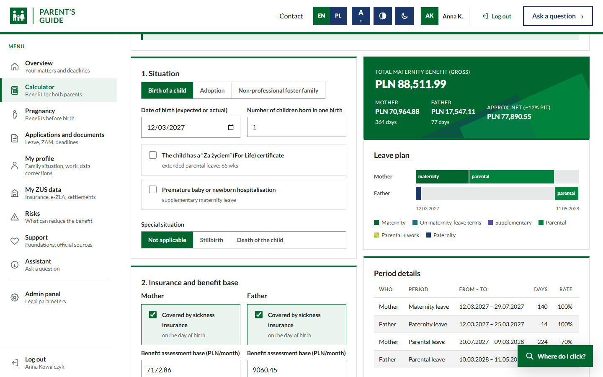

<table>
  <tr>
    <td width="50%">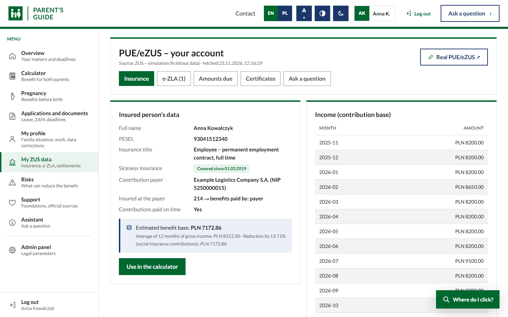</td>
    <td width="50%">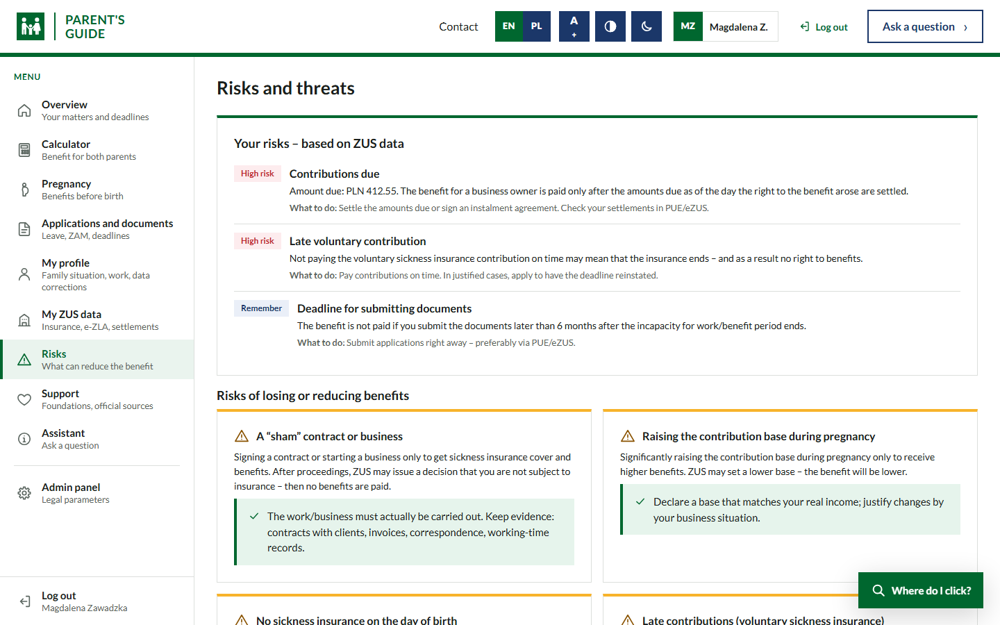</td>
  </tr>
  <tr>
    <td><b>My ZUS data</b> – simulated PUE/eZUS account with the estimated benefit base, which can be used in the calculator.</td>
    <td><b>Risks</b> – risks found in the person's own data (here: a business owner with contributions due), each with what to do.</td>
  </tr>
  <tr>
    <td>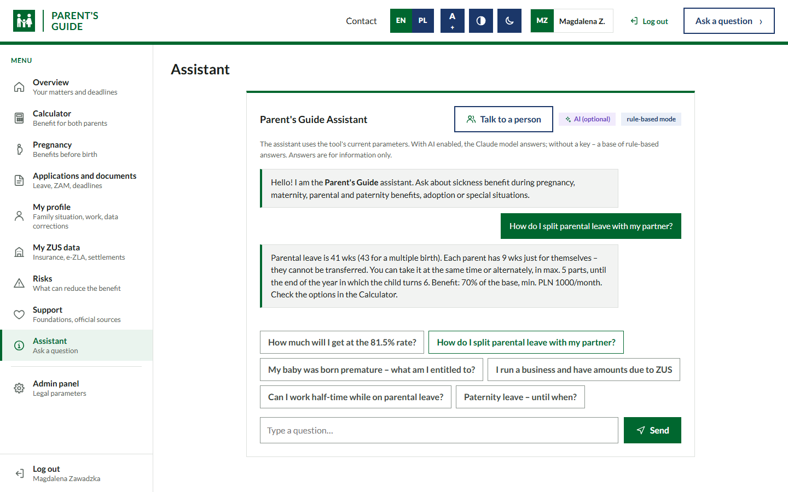</td>
    <td>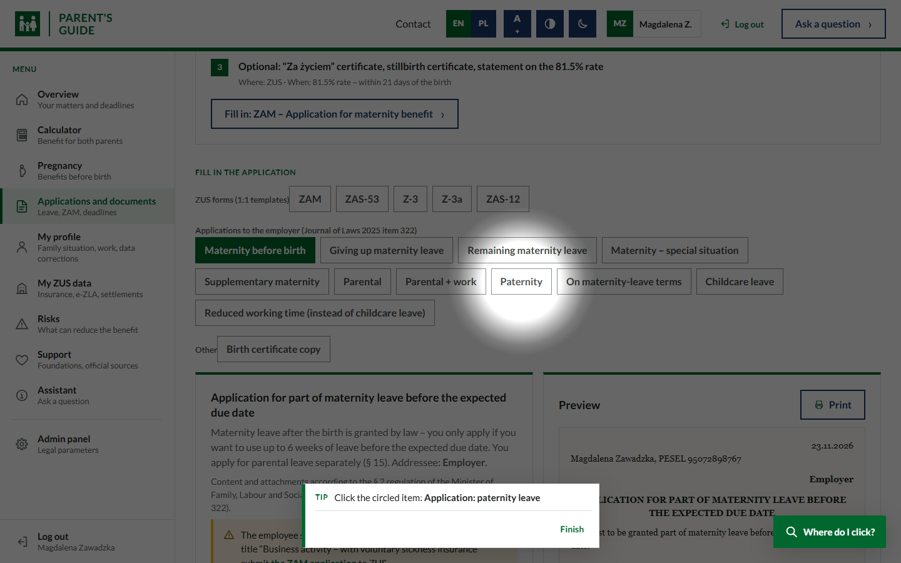</td>
  </tr>
  <tr>
    <td><b>Assistant</b> – plain-language answers based on the current legal parameters (AI or rule-based).</td>
    <td><b>“Where do I click?” helper</b> – asked where to apply for paternity leave, it opens the right page and circles the button.</td>
  </tr>
</table>

Every page also has a **Helper** (floating button). Ask “where do I submit the paternity leave application?” and it circles on screen where to click; after the first login it offers a tutorial.

---

## Test accounts

Available on the login page (quick login or after the simulated QR scan). All people are fictitious.

| Person | Scenario |
|---|---|
| **Anna Kowalczyk** | Employment contract in a large company (>20 insured), so the benefits are paid by the employer. Plans to split leave with her partner. |
| **Piotr Kowalczyk** | Father. The employer reports ≤20 people, so the benefit (paternity, parental) is paid by ZUS. |
| **Magdalena Zawadzka** | Business since May 2026, base raised during pregnancy, contributions due. Many risks. |
| **Katarzyna Lis** | Contract of mandate without sickness insurance, the contract ends before the birth. No right to benefits. |
| **Ewa Nowicka** | Adoptive parent. Took in a 3-year-old child and applied for adoption. |

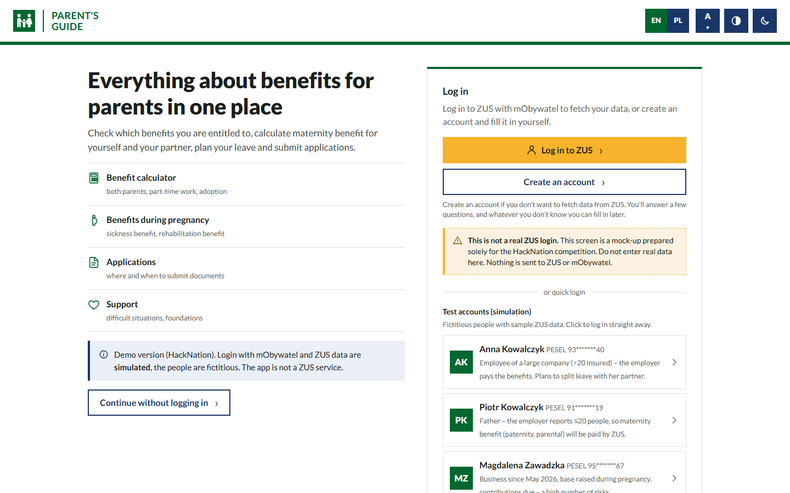

---

## Quick start

Requirements: **Node.js 20+** and npm.

```bash
npm install
npm run dev            # http://localhost:3000
```

Production build:

```bash
npm run build
npm start
```

| Command | Description |
|---|---|
| `npm run dev` | development server (Turbopack) with live reload |
| `npm run build` | production build |
| `npm start` | run the production build |
| `npx tsc --noEmit` | TypeScript type check |

---

## Configuration

Set environment variables in `.env.local` (template in `.env.example`) or in your hosting settings.

| Variable | Default | Description |
|---|---|---|
| `ADMIN_PIN` | `1234` | PIN for the `/admin` panel (checked by the server). **Change it for a public deployment.** |
| `SESSION_SECRET` | derived from `ADMIN_PIN` | Key for signing session and account cookies. **For a public deployment set a long random string.** |
| `ANTHROPIC_API_KEY` | – | Enables the AI features (assistant, helper, reading PDF scans). Without a key the app runs in rule-based mode. |
| `CLAUDE_MODEL` | `claude-sonnet-5-5` | AI model. |

---

## Architecture

**Stack:** Next.js 15 (App Router, Turbopack), React 19, TypeScript, plain CSS (no UI framework), `unpdf` (text from PDF), `@anthropic-ai/sdk` (optional AI).

```
src/
├── app/
│   ├── page.tsx                login (ZUS / mObywatel mock-up + QR, test accounts)
│   ├── nowe-konto/             account survey without ZUS data
│   ├── (app)/                  screens after login (shared layout with menu)
│   │   ├── pulpit/  kalkulator/  ciaza/  wnioski/  zus/  profil/
│   │   └── sprawy/  ryzyka/  wsparcie/  asystent/  admin/  wiecej/
│   ├── api/                    REST API (Next.js Route Handlers)
│   ├── globals.css             the whole visual system (tokens, components, themes)
│   ├── layout.tsx              <html>, appearance and language settings before the first render
│   └── icon.svg                browser tab icon
├── components/
│   ├── Shell.tsx               header, menu, logo, accessibility buttons, EN / PL switch
│   ├── I18nRuntime.tsx         translates the page to English in the browser
│   ├── AppContext.tsx          session, parameters, api() helper
│   ├── FloatingGuide.tsx       “where to click” helper + tutorial
│   ├── OfficialForm.tsx        ZUS forms: fields to fill in + printout in the template layout
│   └── Icon.tsx  Markdown.tsx  Share.tsx  ui.tsx
└── lib/
    ├── i18n/                   language switching: t(), useLang(), en.json (Polish → English dictionary)
    ├── params.ts               legal parameters (rates, leave lengths, deadlines) + descriptions for the panel
    ├── store.ts                saving parameters (data/params.json + history)
    ├── engine.ts               rules engine: base, calculator, pregnancy, risks, documents
    ├── docparse.ts             ZUS document parser (Z-3, Z-3a, ZAM, ZAS-53, ZAS-12, e-ZLA…)
    ├── zusforms.ts             ZAM and ZAS-53 templates (1:1 wording) + validation
    ├── zusforms-platnik.ts     Z-3, Z-3a, ZAS-12 templates (1:1 wording) + validation
    ├── wnioski-pracodawca.ts   applications to the employer per Journal of Laws 2025 item 322 (§ 2–§ 20) + validation
    ├── mock.ts                 simulated ZUS / mObywatel data (fictitious people)
    ├── cases.ts                built-in test cases with the expected result
    ├── quiz.ts                 survey questions (shared by client and server)
    ├── users.ts                survey accounts + corrections to ZUS data
    ├── session.ts              simulated session (signed pp_session cookie)
    ├── cookie.ts               signed cookies (HMAC)
    ├── apps-client.ts          list of sent applications in the browser
    ├── guide.ts                registry of places for the helper (data-guide attributes)
    ├── support.ts              help organisations and official sources
    └── ai.ts                   Claude integration (optional)
```

### How the translation works

The source text of the app is Polish (the forms reproduce Polish official templates word for word). English comes from a dictionary, `src/lib/i18n/en.json`, that maps every user-visible Polish string to English, plus patterns for text with values inserted at runtime (e.g. `Urlop ojcowski – {0} dni ({1})` → `Paternity leave – {0} days ({1})`).

- `I18nRuntime` translates text nodes and the `placeholder`, `title`, `aria-label` and `alt` attributes after hydration and whenever React changes the DOM (MutationObserver), so components keep rendering Polish and React never sees a server/client mismatch. Until the first pass is done the page is hidden, so Polish text never flashes.
- Text that does not reach the page as-is goes through `t()`: Markdown answers of the assistant and the helper, and the share text.
- With AI enabled, the assistant and the helper receive the language and answer in English. In rule-based mode the Polish answers are translated with the dictionary, and English keywords are recognised.
- The choice is stored in `localStorage` (`lang`); English is the default. Amounts are shown as `PLN 1,234.56` in English.
- Element contents marked with `data-no-i18n` are never translated.

When you add or change Polish text in the UI, add its English translation to `en.json`; text without a translation stays in Polish.

---

## REST API

| Method | Path | Description |
|---|---|---|
| `GET` | `/api/auth/mobywatel` | list of test accounts + current session |
| `POST` | `/api/auth/mobywatel` | `{ personaId }`, simulated login |
| `DELETE` | `/api/auth/mobywatel` | log out |
| `GET / POST / PUT` | `/api/accounts` | survey account: read, create, complete |
| `GET / PUT / DELETE` | `/api/profile` | profile data, saving corrections, restoring ZUS data |
| `POST` | `/api/calculate` | benefit calculator (both parents, work, adoption, special situations) |
| `POST` | `/api/base` | benefit base with calculation steps |
| `POST` | `/api/pregnancy` | benefits during pregnancy |
| `GET` | `/api/documents?title=&benefit=&insured=` | which documents, where and when to submit |
| `POST` | `/api/documents/parse` | reading data from a PDF (rule-based parser, optionally AI) |
| `GET / POST` | `/api/applications` | applications submitted in the session, simulated sending with UPO |
| `GET` | `/api/cases`, `/api/cases/{id}` | test cases, a case with its calculation |
| `GET` | `/api/zus/profile` | simulated KSI/PUE data |
| `GET` | `/api/zus/ezla` | simulated e-ZLA preview |
| `GET` | `/api/zus/debt?date=YYYY-MM-DD` | simulated certificate of amounts due |
| `GET` | `/api/support?obszar=` | help organisations and official sources |
| `POST` | `/api/assistant` | assistant (AI or rules); optional `lang: "en"` |
| `POST` | `/api/guide` | helper: `{ question, path, lang? }`, returns `{ answer, steps, mode }` |
| `GET / PUT / DELETE` | `/api/params` | legal parameters, saving (PIN), restoring defaults |

API messages are in Polish; the English interface translates them when they are displayed.

---

## AI features

| Feature | With AI | Without AI |
|---|---|---|
| Calculations, entitlements, deadlines, risks | **no**, always the deterministic rules engine (`engine.ts`) | – |
| Reading data from an uploaded document | **optional**: Claude reads the PDF (including scans) when the parser's confidence is low or after clicking “Read again with AI” | rule-based parser (`docparse.ts`) on the PDF text layer |
| Assistant | **optional**: Claude gets the current parameters from the panel and the profile context | base of rule-based answers |
| “Where to click” helper | **optional**: understands freely worded questions | keyword matching (`guide.ts`) |

AI results are marked in the interface with a purple “AI” badge and do not go directly into calculations: the user confirms the data that was read.

---

## Data storage

| Data | Where | Notes |
|---|---|---|
| Legal parameters + history | `data/params.json`, `data/params-history.json` | edited in `/admin` |
| Session | signed `pp_session` cookie | 4 hours, HMAC signature – the value cannot be tampered with |
| Survey account | signed `pp_account` cookie | only in this browser, deleted on logout |
| Corrections to ZUS data | signed `pp_overrides` cookie | only fields that differ from ZUS, only in the current session |
| Sent applications, saved plan | browser `sessionStorage` | the “Sent in this session” list; the server only issues the UPO |
| Form drafts (survey, applications) | browser `sessionStorage` | survive a page refresh |
| Appearance settings and language | browser `localStorage` | |

User data is not stored on the server, so the app works the same on serverless hosting (e.g. Vercel, multiple instances) and the data is not visible to other visitors. The `data/` directory (parameters from the admin panel) is created automatically on the first save; **on read-only hosting** the parameters are kept in server memory and return to the defaults after a redeploy.

---

## Accessibility, appearance and language

- **Header buttons:** language switch (**EN / PL**, English by default), larger text (3 levels), high contrast, light / dark theme. The settings are applied before the first render, without flicker. On a phone they are in the “More” tab.
- **Responsive:** side menu on a computer, bottom navigation and a back button on a phone.
- A “Skip to content” link, field labels, ARIA roles in dialogs and progress bars, keyboard support (Esc closes dialogs).
- **Appearance** modelled on e-government portals (green colour scheme, service tiles, cards). The visual system is described in [`DESIGN.md`](DESIGN.md). The app **does not use** the ZUS logo, the national emblem or any other official marks. Its own mark is a minimalist family pictogram.
- **Language:** plain wording, with euphemisms where the topic is sensitive (e.g. “amounts due” instead of “debt”).

<table>
  <tr>
    <td width="50%" align="center">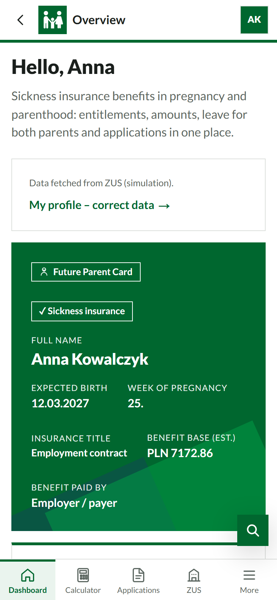</td>
    <td width="50%" align="center">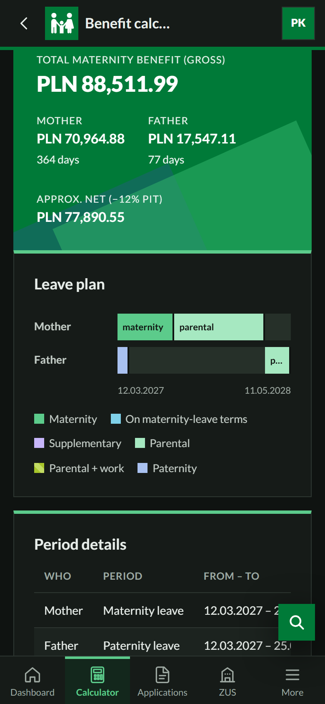</td>
  </tr>
  <tr>
    <td align="center">On a phone: bottom navigation and a back button.</td>
    <td align="center">Dark theme: calculator results and the leave plan.</td>
  </tr>
</table>

---

## Mapping to the challenge requirements

| Requirement | Where |
|---|---|
| a) benefits during pregnancy (sickness benefit, rehabilitation benefit, benefit equal to maternity benefit, including no entitlement) | `/ciaza` → `POST /api/pregnancy` |
| b) calculator for both parents (number of children, “Za życiem”, premature baby, stillbirth / death of the child) | `/kalkulator` → `POST /api/calculate` |
| c) combining parental leave with work | `/kalkulator`, section 3 (¼, ⅓, ½ time) |
| d) simulation of both parents sharing the leave | `/kalkulator` (taking over maternity leave, 9 non-transferable weeks, one after the other / at the same time, ready-made options, comparison of 81.5% with 100% / 70%) |
| e), j) adoption and non-professional foster family | `/kalkulator` → “Adoption” / “Foster family” (age limits 14 / 7 / 10 years) |
| f) calculator with the individual benefit base from a specific case | `/sprawy` (12 test cases + PDF upload) → `GET /api/cases/{id}`, `POST /api/documents/parse` |
| g) documents, deadlines, how to submit (payer or ZUS) | `/wnioski` → `GET /api/documents` |
| h) threats and risks | `/ryzyka` + risks calculated from the person's data (sham employment, raising the base, end of insurance, amounts due, missing code B) |
| i) charitable organisations | `/wsparcie` → `GET /api/support` |
| mObywatel login (simulated) | `/` → “Log in to ZUS” → “Log in with mObywatel” (QR) → `POST /api/auth/mobywatel` |
| fetching data from ZUS (simulated) | `/zus`, the “Fetch data from ZUS” button in the calculator → `GET /api/zus/profile` |
| amounts due as of the day the right arises | `/zus` → Amounts due → `GET /api/zus/debt?date=` |
| e-ZLA preview | `/zus` → e-ZLA → `GET /api/zus/ezla` |
| PUE/eZUS (question, account data) | `/zus` → Ask a question |
| leave and benefit applications + sending | `/wnioski` (ZAM, ZAS-53, Z-3, Z-3a, ZAS-12 in the ZUS template layout; applications to the employer per Journal of Laws 2025 item 322) → `POST /api/applications` (UPO) |
| copy of the birth certificate | `/wnioski` → Birth certificate copy |
| redirects to ZUS / MRPiPS / PIP | `/wsparcie` → Official sources |
| admin panel for parameters | `/admin` → `GET/PUT/DELETE /api/params` (versioning + change history) |
| uploading / choosing applications for testing | `/sprawy` |
| responsive design | the whole interface: side menu on a computer, bottom navigation on a phone |

---

## Compliance of forms with ZUS templates

The forms filled in by the insured person or the contribution payer reproduce the 2026 ZUS templates. One form description (`src/lib/zusforms.ts`, `src/lib/zusforms-platnik.ts`) is used both for filling in on screen and for printing – the on-screen and paper text cannot drift apart. In the Polish version the wording is the official one; the English version shows a translation of it.

| Form | Filled in by | Template (print order no.) | When |
|---|---|---|---|
| **ZAM** – Application for maternity benefit | insured person | 2965/26, Information 2993/26 | all periods: maternity / on maternity-leave terms, parental, supplementary, paternity |
| **ZAS-53** – Application for sickness benefit | insured person | 2869/26 | business owners, cooperating persons, clergy, seafarers, incapacity after the end of insurance |
| **Z-3** – Contribution payer's certificate | payer (employer) | 2924/26 | an employee, when the benefit is determined by ZUS |
| **Z-3a** – Contribution payer's certificate | payer (e.g. principal) | 2929/26 | people insured under other titles (except business owners, clergy, seafarers) |
| **ZAS-12** – Contribution payer's certificate | payer | 2923/26 | sickness / care benefit for a further period |

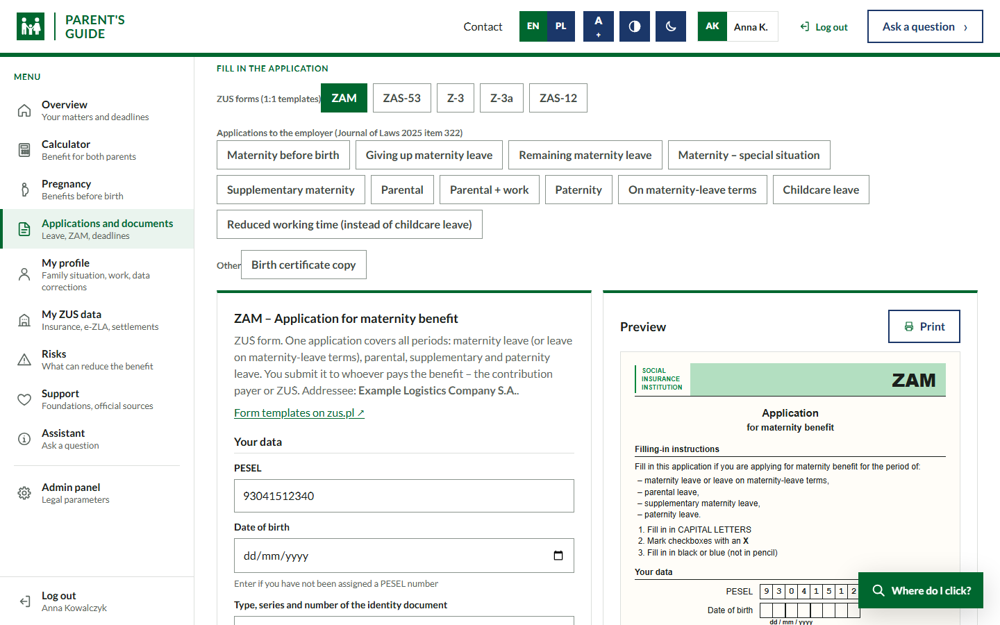

### What is reproduced 1:1

- **Layout and wording:** the order of sections and fields, labels, hints under fields, checkboxes, YES/NO questions, statements, the “Filling-in instructions”, the “Instructions” / “Information on the application”, the GDPR clause and the notice on Article 63 of the Benefits Act.
- **Tables in Z-3 and Z-3a:** headers (including column groups), column numbering and the number of rows as in the template.
- **Text word for word** – including errors in the template, e.g. “sytemu” (ZAS-12), “jeżeli nadano numeru PESEL” (Z-3a), “wykazane sekcji” (Z-3). Only errors introduced when extracting text from the PDF were corrected (e.g. “niedłużej” → “nie dłużej”, “profi lu” → “profilu”).
- **Printout:** boxes for PESEL, NIP, REGON, the account number and dates (dd/mm/yyyy), an X in checkboxes, values in CAPITAL LETTERS (as the template's instructions require), the “Information” for ZAM on a separate page.
- **Filling in from the profile:** the person's and payer's data, leave dates, e-ZLA, and in Z-3 / Z-3a – income for 12 months. The app does not guess the address or place of birth.

### Deliberate differences

- The ZUS logo is not an image – the header is recreated with text and colour.
- Page breaks are set by the browser; there is no “Page x of y” numbering or the “Skład: Poligrafia ZUS…” footer.
- “Period (from–to)” fields are two date fields on screen, and the e-ZLA series and number is a separate field; on the printout everything goes into one field, as in the template.
- Signature: handwritten on the printout, simulated trusted-profile signature when sent electronically.

### Validation

The rules that follow from the templates and the law are checked, including:

- PESEL, NIP and REGON (check digit) and the “give if no … has been assigned” rule (e.g. without PESEL – date of birth and identity document);
- Polish postcode 00-000, 26-digit account number;
- periods: date order, maternity leave length by number of children, max. 6 weeks before the birth, parental leave in max. 5 parts until the end of the year in which the child turns 6, paternity leave of 7–14 days in max. 2 parts until the child is 12 months old;
- the 81.5% rate only with an application within 21 days of the birth and only together with parental leave;
- supplementary maternity leave: the birth circumstance is marked and the period of the hospital stay is given (from 37 weeks – min. 2 days, the first between the 5th and 28th day after the birth);
- “If YES …” fields required after ticking YES, mutually exclusive answers (e.g. “up to 20” / “more than 20 insured”, “NO” in point 6 of Z-3);
- tables: year YYYY, month 1–12, quarter 1–4, number of days, amounts, percentage of contribution deducted 0–100.

### What is not included and why

- **ZUR and ZAO** – these forms do not exist; the scope of the ZAM application covers all maternity benefit periods.
- **Z-3b** – not used: the “Information” for ZAM lists only Z-3 and Z-3a, and a self-employed person does not submit a payer's certificate (ZAS-53 / ZAM without Z-3).
- **e-ZLA** – issued by the doctor; the app only reads it.
- **Applications to the employer** – these are not ZUS forms and have no official graphic template; their content and attachments are set by the regulation (see below).

### Applications to the employer – compliance with Journal of Laws 2025 item 322

The regulation of the Minister of Family, Labour and Social Policy of 11 March 2025 on applications concerning employees' parenthood rights does not set the look of the application – it sets what the application **contains** and which documents are **attached** to it. The app creates a separate application for each paragraph (`src/lib/wnioski-pracodawca.ts`):

| § | Application | Basis in the Labour Code |
|---|---|---|
| 2 | part of maternity leave before the expected due date | Art. 180 § 2 |
| 3, 4 | giving up the remaining part of maternity leave (on maternity-leave terms) and returning to work – after 14 weeks, or after 8 weeks with a certificate of inability to live independently | Art. 180 § 8 |
| 5 | the remaining part of maternity leave / on maternity-leave terms / parental leave for the father or another close family member | Art. 180 § 9 |
| 6–13 | part of the leave in a special situation: the mother in hospital (§ 6, § 7), death (§ 8, § 10), abandonment of the child (§ 9, § 11), uninsured mother with a certificate (§ 12), a mother without an insurance title takes up employment (§ 13) | Art. 180 § 16, § 17 |
| 14 | supplementary maternity leave | Art. 180² § 4, Art. 183 § 3¹ |
| 15 | parental leave or part of it | Art. 182¹ᵈ § 1, Art. 183 § 4–4² |
| 16 | combining parental leave with work | Art. 182¹ᵉ § 2 |
| 17 | paternity leave or part of it | Art. 182³ § 2 |
| 18 | leave on maternity-leave terms | Art. 183 § 6 |
| 19 | childcare leave or part of it | Art. 186 § 7 |
| 20 | reduced working time instead of childcare leave | Art. 186⁷ § 1 |

How compliance is ensured:

- **The content of the application** is the numbered elements from “para. 1” of the given paragraph, in the wording of the regulation (e.g. “the period for which parental leave or part of it is to be granted: …”), with the values entered by the employee.
- **Attachments** are listed in the wording of the regulation and depend on the situation: e.g. a copy of the “Za życiem” certificate only with extended parental leave, a copy of the adoption decision only for an adopted child, the documents from “para. 4” (taking the child in for upbringing, deferred compulsory schooling) only for a child taken in for upbringing.
- **Statements** that the regulation requires (e.g. on the other parent's intentions, on taking paternity leave) are written into the text of the letter.
- **“Applies accordingly” (para. 3):** applications under § 5–§ 13 can also be submitted for leave on maternity-leave terms and parental leave – the names of the leave in the text change automatically, and the element on leave “used before the birth” (applies only to maternity leave) is then omitted. For § 15 for a child taken in for upbringing only para. 1 applies, so the attachments are only the documents from para. 4.
- **§ 21–§ 23:** a foreign birth document from outside the EU/EFTA/Switzerland/social security agreement states (or not in their official language) gets a note about a translation into Polish; documents in the personnel file can be indicated and are then not attached; with copies, the letter includes an undertaking to show the originals at the employer's request.
- **Validation** enforces the conditions of the regulation and the Labour Code: e.g. 6 weeks before the birth (§ 2), returning to work after 14 / 8 weeks at the earliest (§ 3, § 4), taking over after 8 weeks in the situations under § 6, § 7, § 9, the takeover date after the day of death / abandonment (§ 8–§ 11), in § 13 only the father applies, supplementary leave directly after maternity leave and in full weeks, parental leave in max. 5 parts and within the pool, paternity leave of 7–14 days until the child is 12 months old (for adoption – 12 months from the decision becoming final), childcare leave up to 36 months, applications submitted at least 21 days in advance where the Labour Code requires it.

### When ZUS changes a template

The content of each form is in one place (`ZAM`, `ZAS53` in `zusforms.ts`; `Z3`, `Z3A`, `ZAS12` in `zusforms-platnik.ts`). Changing a label or adding a field means editing that list – the screen, the printout and validation use it automatically. The print order number in the comment at the top of the file shows which template version the form was compared with. Remember to update the English translation in `src/lib/i18n/en.json` as well.

---

## Assumptions to verify with ZUS

- Supplementary maternity leave calculated according to the “Information” for ZAM: one week of leave for each week the child is in hospital – until the end of the 15th week after the birth (before 28 weeks of pregnancy or ≤1000 g), until the end of the 8th week (28–36 weeks, >1000 g); from 37 weeks – a stay of at least 2 consecutive days, the first between the 5th and 28th day after the birth, counted from the 5th day until the end of the 8th week. The app's assumptions: an incomplete week counts as a full week, the day of birth = day 0. The values can be changed in the panel.
- The 9 weeks of parental leave do not pass to the other parent when that parent is not insured. The full pool is available only in statutory exceptions (a switch in the calculator).
- The net amount is approximate: 12% PIT advance, without the tax-reducing amount.
- Benefit per month = base × rate. Benefit for a period = daily rate (1/30) × number of days.
- The list of help organisations needs to be verified by ZUS.

---

## Path to production

- **Login:** National Node / login.gov.pl (OIDC/SAML) instead of the mObywatel mock-up.
- **Data:** integration with KSI/PUE through the ZUS API instead of `mock.ts`.
- **Storage:** a database with auditing and roles (e.g. Azure AD / Keycloak) instead of JSON files.
- **Applications:** e-Delivery (e-Doręczenia) / PUE and a trusted profile signature instead of the simulated UPO.
- **Content:** verification of parameters, assumptions and the list of organisations by ZUS.
- **Translation:** an i18n library with translation keys instead of the Polish → English dictionary, and a review of the English wording by a translator.

---

<sub>Project prepared for the HackNation competition. It is not affiliated with the Social Insurance Institution (ZUS) or the mObywatel app. All personal data in the app is fictitious.</sub>
